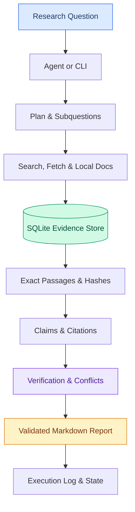
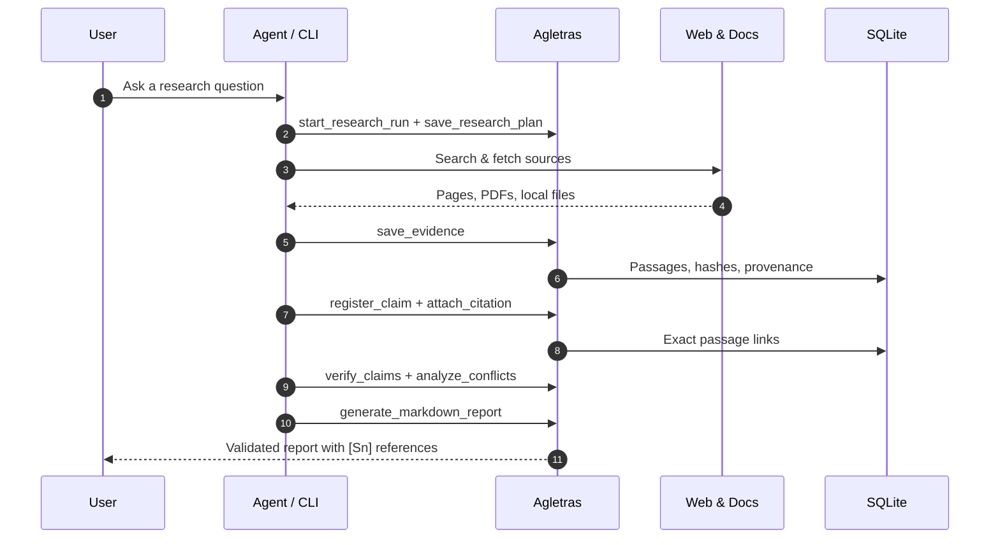
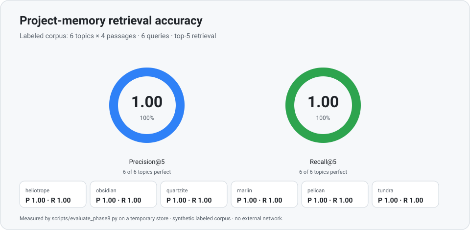
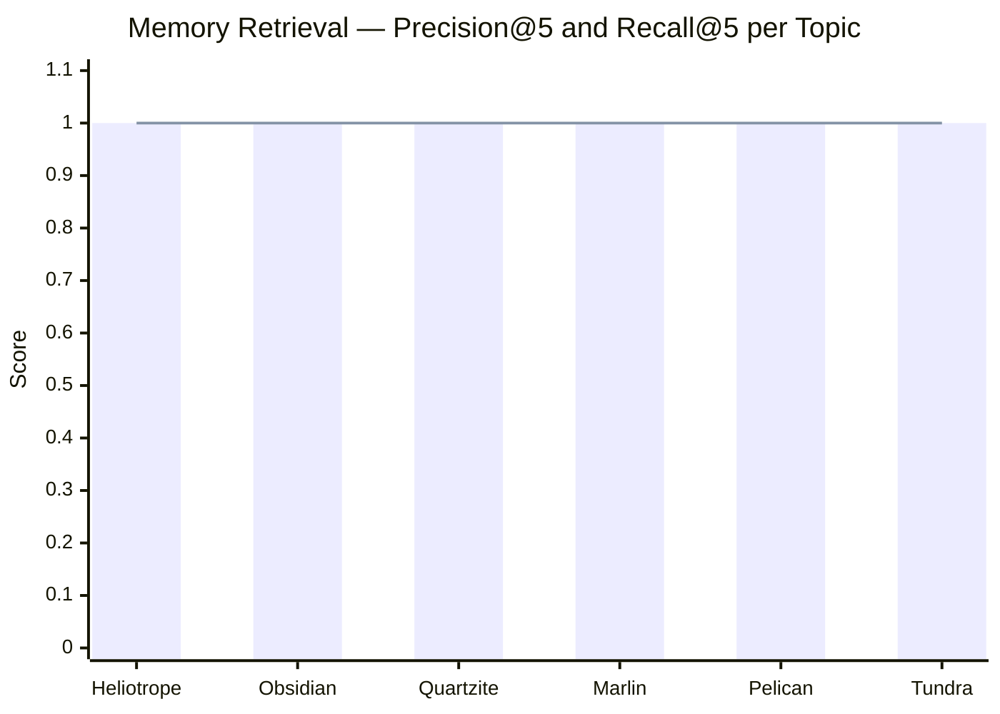
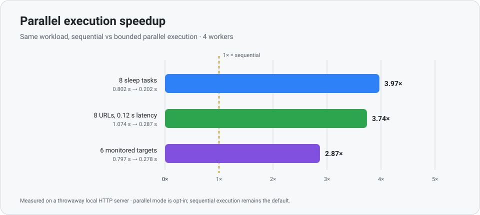
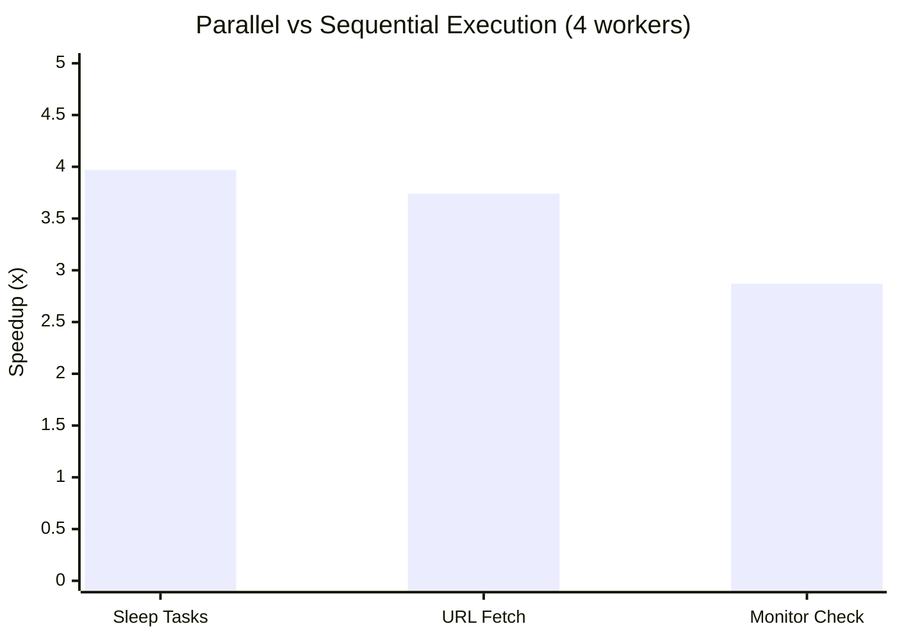
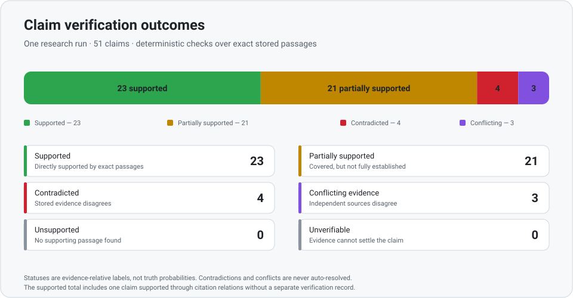
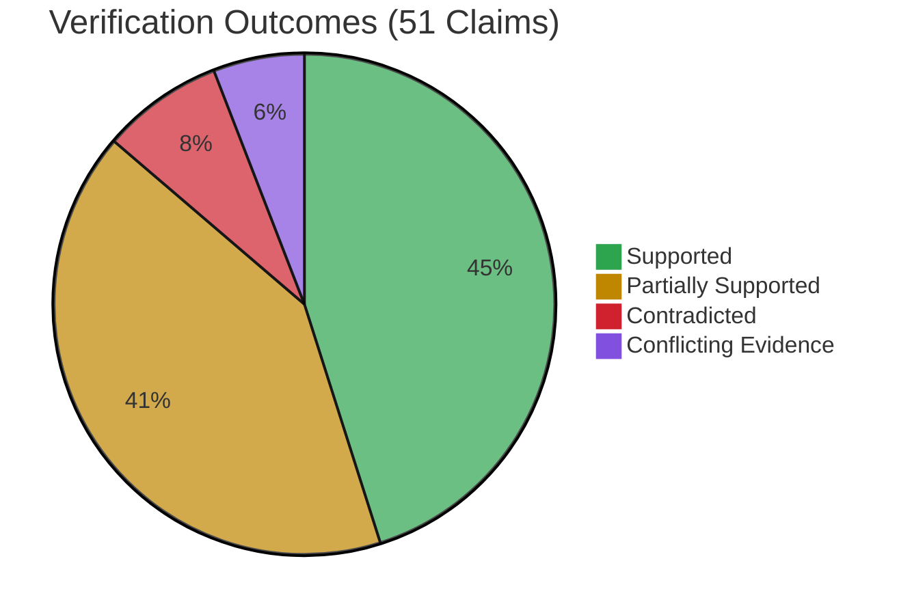

<div align="center">

# Agletras MCP

**Local-first, zero-cost research infrastructure for AI agents.**

Turn a research question into a traceable, citation-validated report — with exact passages, explicit verification statuses, and no paid APIs.


[Quick Start](#quick-start) · [Features](#what-you-get) · [Accuracy & Performance](#accuracy--performance) · [Architecture](#architecture) · [Tool Catalog](#tool-catalog) · [Docs](#documentation)

</div>

---

## Why Agletras?

Most research agents stop at "the model wrote an answer." **Agletras keeps the evidence.**

| | Traditional Agent | Agletras |
|---|---|---|
| **Citations** | Vague references | Exact passages with SHA-256 hashes |
| **Verification** | Trusts model output | 6 explicit statuses per claim |
| **Conflicts** | Silently resolved | Both sides stored and visible |
| **Storage** | Ephemeral | SQLite with full provenance |
| **Cost** | API fees | **\$0** — free search + free retrieval |
| **Privacy** | Cloud-dependent | **100% local** — your data stays on disk |

---

## What You Get

| Capability | Description |
|---|---|
| **Source Collection** | Fetches web pages; extracts PDF, DOCX, XLSX, CSV/TSV, Markdown, plain text, and HTML with provenance and checksums |
| **Evidence Library** | Splits content into stable passages with exact offsets and SHA-256 hashes; de-duplicates by canonical identity |
| **Claims & Citations** | Links claims to exact passages; rejects fabricated quotations and cross-source mismatches |
| **Verification** | Deterministic claim-vs-passage checks with explicit status, method, confidence, and limitations |
| **Synthesis Reports** | Structured Markdown with stable `[F#]`, `[Sn]`, and `[IMG#]` identifiers plus source-quality indicators |
| **Research Runs** | Plans subquestions, enforces limits, detects gaps, and stops predictably with remaining gaps visible |
| **CLI & MCP** | Same workflow via `agletras` CLI and 38 MCP tools |
| **Memory & Monitoring** | Recalls stored evidence across runs; watches URLs or local files for meaningful changes |
| **Image Research** | Searches Wikimedia Commons with real metadata; optional vision analysis |

---

## Architecture



### Research Pipeline



---

## Quick Start

### Prerequisites

- Python 3.11+
- `pip`
- [OpenCode](https://opencode.ai) *(optional — CLI works standalone)*

### Install

```bash
git clone <repository-url> agletras-mcp
cd agletras-mcp

python -m venv .venv
source .venv/bin/activate          # Linux / macOS
# .venv\Scripts\Activate.ps1       # Windows PowerShell

pip install -r requirements.txt
pip install -e .
python scripts/make_sample_pdf.py  # optional: generate sample PDF
```

### Run the CLI

```bash
# Check your environment
agletras doctor

# Run a quick research
agletras run "How does the MCP protocol standardize tool discovery?" --depth quick

# Check status and get the report
agletras status <run-id>
agletras report <run-id>
```

> **Exit codes:** `0` success · `4` research failed · `5` partial report with gaps · `130` interrupted (resumable)

### Connect to OpenCode

The project ships an MCP configuration in [`opencode.json`](opencode.json):

```jsonc
{
  "$schema": "https://opencode.ai/config.json",
  "mcp": {
    "servers": {
      "agletras": {
        "type": "local",
        "command": ["python", "scripts/run_mcp.py"],
        "codemode": false
      }
    }
  }
}
```

```bash
opencode mcp list
# expected: agletras  connected
```

### Use the Research Agent

```bash
opencode run --agent research-orchestrator --auto \
  "Research how Content Security Policy headers prevent XSS and cite every claim."
```

---

## Accuracy & Performance

> **Measured results** from the repository's offline evaluation script — not estimates.
> See [`docs/phase8-measurements.md`](docs/phase8-measurements.md) for the full table and reproduction steps.

### Retrieval Accuracy

<p align="center">
  
</p>



| Topic | Returned | Relevant | Precision@5 | Recall@5 |
|---|:---:|:---:|:---:|:---:|
| Heliotrope | 4 | 4 | **1.00** | **1.00** |
| Obsidian | 4 | 4 | **1.00** | **1.00** |
| Quartzite | 4 | 4 | **1.00** | **1.00** |
| Marlin | 4 | 4 | **1.00** | **1.00** |
| Pelican | 4 | 4 | **1.00** | **1.00** |
| Tundra | 4 | 4 | **1.00** | **1.00** |

### Parallel Execution Speedup

<p align="center">
  
</p>



| Workload | Sequential | Parallel | Speedup |
|---|:---:|:---:|:---:|
| 8 sleep tasks | 0.802 s | 0.202 s | **3.97x** |
| 8 URLs (0.12 s latency) | 1.074 s | 0.287 s | **3.74x** |
| 6 monitor targets | 0.797 s | 0.278 s | **2.87x** |

### Claim Verification Outcomes

<p align="center">
  
</p>



### Summary Metrics

| Metric | Result |
|---|---|
| Memory precision@5 | **1.00** (6/6 topics) |
| Memory recall@5 | **1.00** (6/6 topics) |
| Best parallel speedup | **3.97x** (8 tasks, 4 workers) |
| Claim verification coverage | **51/51 claims** in one run |
| Evidence reuse savings | **2 fetches saved** (2 to 0) |
| Resume safety | 0 extra fetches on resume |
| Monitoring false alerts | **0** of 6 targets |

### Reproduce

```bash
python scripts/evaluate_phase8.py --out docs/phase8-measurements.md
python scripts/make_readme_assets.py
```

---

## Claim Verification Statuses

The verification layer records what the evidence can establish — it does **not** predict truth.

```mermaid
stateDiagram-v2
    [*] --> Supported: Passage directly establishes claim
    [*] --> PartiallySupported: Passage covers claim partially
    [*] --> Contradicted: Evidence disagrees with claim
    [*] --> ConflictingEvidence: Sources disagree with each other
    [*] --> Unsupported: No supporting passage found
    [*] --> Unverifiable: Evidence cannot settle claim

    state Supported {
        direction LR
    }
    state ConflictingEvidence {
        direction LR
    }
```

| Status | Meaning |
|---|---|
| `SUPPORTED` | A stored passage directly establishes the claim |
| `PARTIALLY SUPPORTED` | Passage covers the claim but not every part |
| `CONTRADICTED` | Stored evidence disagrees with the claim |
| `CONFLICTING EVIDENCE` | Independent sources disagree with each other |
| `UNSUPPORTED` | No supporting passage was found |
| `UNVERIFIABLE` | Stored evidence cannot settle the claim |

> Facts, inferences, and unverified statements stay in **separate report sections**. Conflicts remain visible with evidence on both sides.

---

## Tool Catalog

The MCP server exposes **38 tools**. OpenCode prefixes them with the server name (e.g., `agletras_health_check`).

| Group | Tools |
|---|---|
| **Server & Retrieval** | `health_check`, `search_web`, `fetch_url`, `extract_pdf`, `collect_sources`, `collect_local_folder`, `extract_document` |
| **Source Store** | `save_source`, `get_source`, `list_sources`, `search_sources`, `export_report`, `stats` |
| **Evidence Library** | `start_research_run`, `save_evidence`, `search_evidence`, `register_claim`, `attach_citation`, `get_claim_citations`, `get_research_history`, `generate_report`, `validate_report` |
| **Research Planning** | `save_research_plan`, `update_subquestion`, `log_run_event`, `start_followup_round`, `finish_research_run` |
| **Verification & Synthesis** | `extract_claims`, `verify_claims`, `analyze_conflicts`, `generate_markdown_report`, `get_report` |
| **Images** | `search_images`, `analyze_image` |
| **Memory & Monitoring** | `search_memory`, `monitor_add_target`, `monitor_check`, `monitor_changes` |

### CLI Commands

```text
agletras run / resume / status / pause / cancel / inspect / recover
agletras report / list / events / observatory / export
agletras profiles / jobs / monitor
agletras config / doctor / preflight / health
agletras ledger / workflows / security / improve
```

---

## At a Glance

| | |
|---|---|
| **Interfaces** | MCP stdio server + `agletras` CLI |
| **Storage** | SQLite (sources, passages, claims, citations, runs, reports, logs) |
| **Search** | DuckDuckGo HTML endpoint or Wikipedia API (no key) |
| **Documents** | PDF, DOCX, XLSX, CSV/TSV, Markdown, plain text, HTML |
| **Runtime deps** | `mcp` and `pypdf` — two pure-Python packages |
| **Python** | 3.11+ |
| **Cost** | \$0 |
| **Credentials** | None required |
| **Privacy** | Local-first; state stays on disk under your control |

---

## Data, Privacy & Safety

- **Local state** — SQLite database, cache, and reports live under the project directory (`data/`, `cache/`, `reports/`) and are Git-ignored
- **SSRF protection** — localhost, private, link-local, multicast, and shared addresses blocked by default (including redirects)
- **Local-file boundaries** — folder collection confined to explicit access roots; `..` traversal and symlink escapes refused
- **No secrets** — no API keys or credentials required; optional model endpoints are opt-in and never hardcoded
- **Citation integrity** — non-empty quotes must occur verbatim in the cited passage, or the citation is rejected
- **Honest failure** — failed checks never reported as changes; missing evidence never invented
- **Security research** — the `security` workflow is authorization-gated and refuses invalid authorization

---

## Project Structure

```text
agletras-mcp/
├── src/agletras_mcp/          # Core: MCP server, CLI, evidence, verification, synthesis
│   ├── server.py              # MCP stdio server (38 tools)
│   ├── cli.py                 # agletras command-line interface
│   ├── pipeline.py            # End-to-end research pipeline
│   ├── evidence.py            # Evidence library and citation tracking
│   ├── verification.py        # Claim verification engine
│   ├── synthesis.py           # Report synthesis
│   ├── search.py              # Web search adapters
│   ├── parallel.py            # Bounded parallel execution
│   ├── memory.py              # Cross-run evidence memory
│   ├── monitor.py             # URL/file change monitoring
│   └── ...                    # 20+ modules
├── tests/                     # Unit tests + stdio protocol tests
├── scripts/                   # Benchmarks, samples, asset generators
├── docs/                      # Reference docs, measurements, SVG assets
├── samples/                   # Generated sample PDF and report
├── .opencode/agents/          # Research-orchestrator agent
├── opencode.json              # Project-local MCP registration
├── config.example.toml        # Annotated TOML configuration
├── .env.example               # All AGLETRAS_* variables with defaults
├── pyproject.toml             # Build configuration
└── requirements.txt           # Pinned dependencies
```

---

## Testing

```bash
python -m unittest discover -s tests -t . -v
```

The test suite is **hermetic**: temporary home directories, local HTTP servers only, and no external network. Some tests exercise POSIX symlinks and signals — use Linux, macOS, or WSL for full coverage.

---

## Documentation

| Document | Contents |
|---|---|
| [`docs/mcp-server.md`](docs/mcp-server.md) | Tool contracts, design decisions, storage schema, verification log |
| [`docs/phase8-measurements.md`](docs/phase8-measurements.md) | Raw benchmark measurements and methodology |
| [`config.example.toml`](config.example.toml) | Annotated configuration file with all options |
| [`.env.example`](.env.example) | Environment variables and defaults |
| [`.opencode/agents/research-orchestrator.md`](.opencode/agents/research-orchestrator.md) | End-to-end research agent prompt |

---

## Design Principles

1. **Evidence before prose.** No report text is treated as a source.
2. **Exactness over convenience.** Citations point at passages, not pages.
3. **Uncertainty is data.** Unsupported and conflicting claims stay visible.
4. **Local first.** The default path needs no account, no key, and no paid API.
5. **Bounded work.** Every run has limits, a stopping rule, and a trace.

---

<p align="center">
  <sub>Built for research that can show its work.</sub>
</p>
